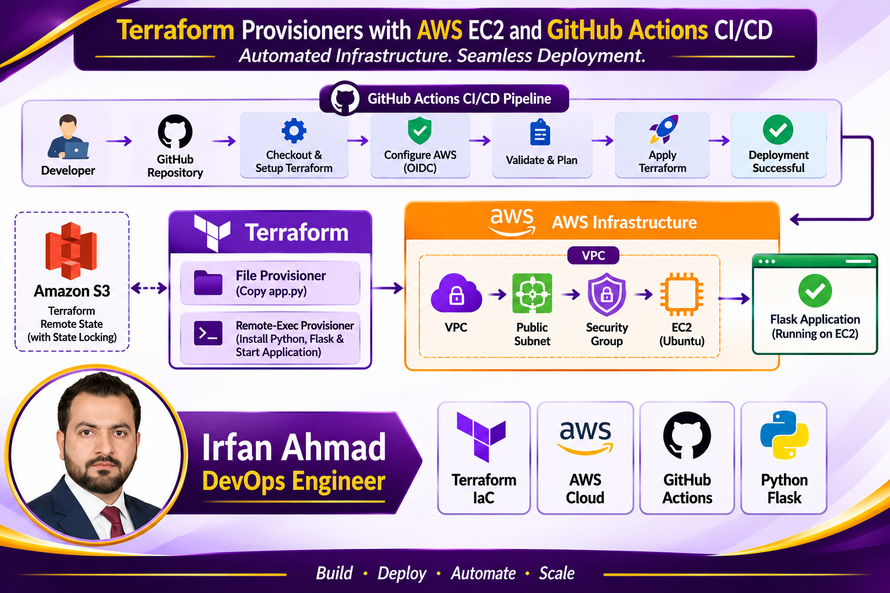
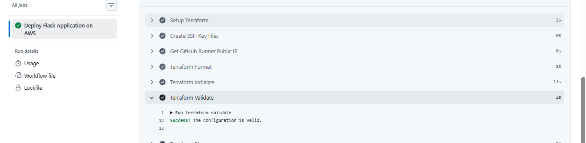
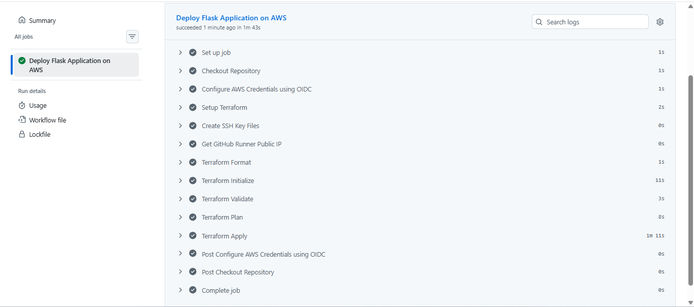
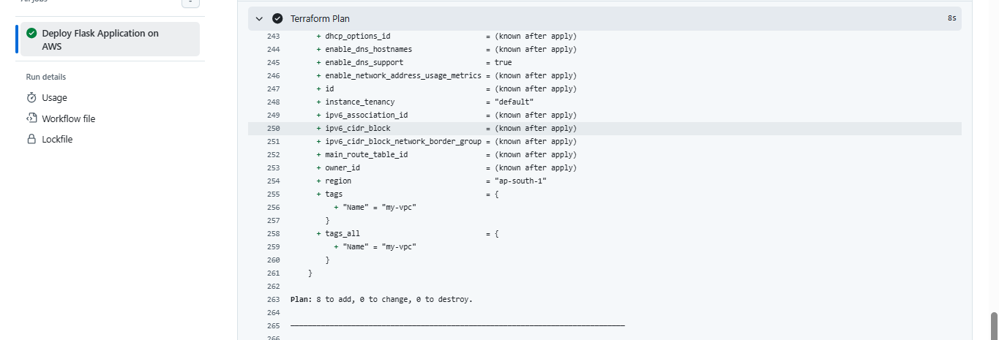
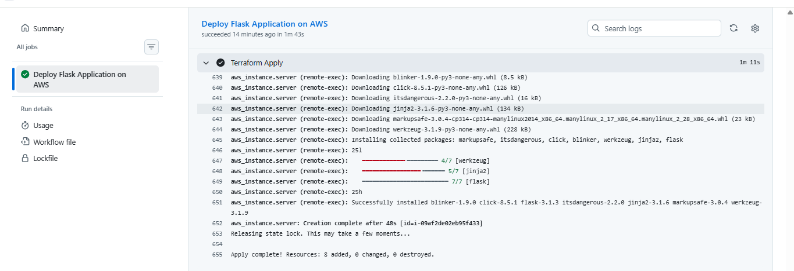
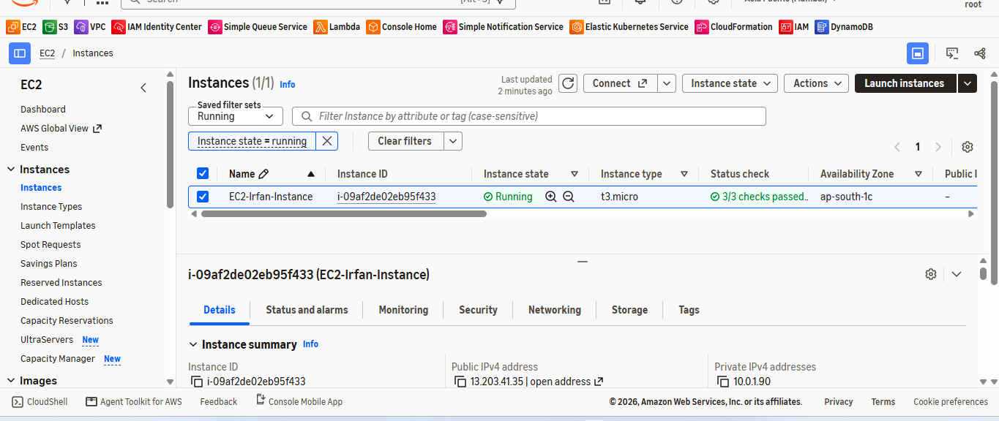
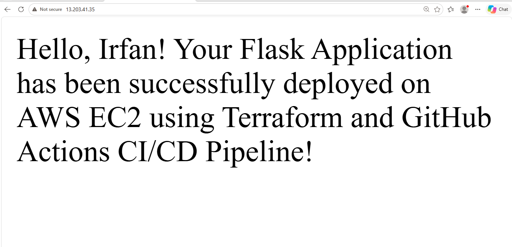
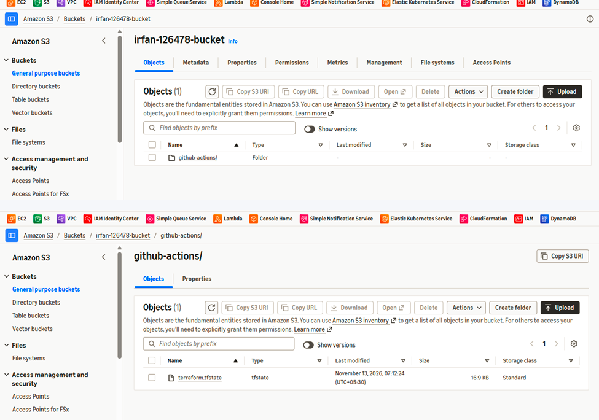
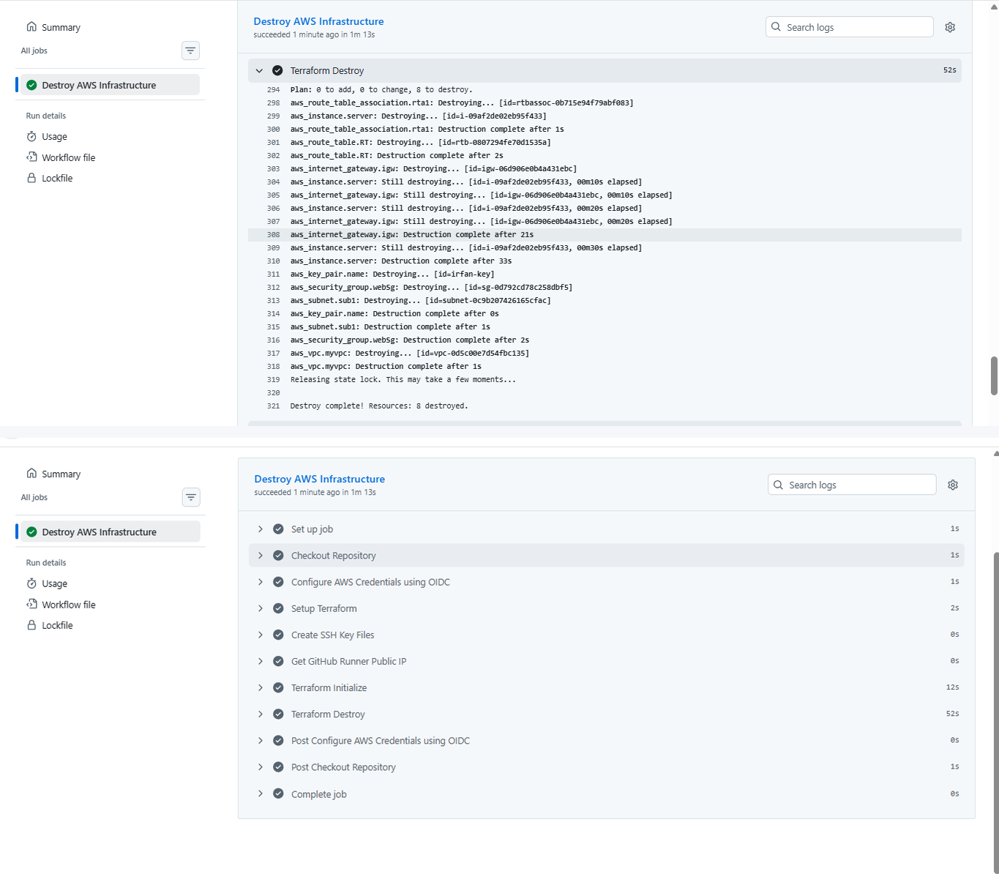
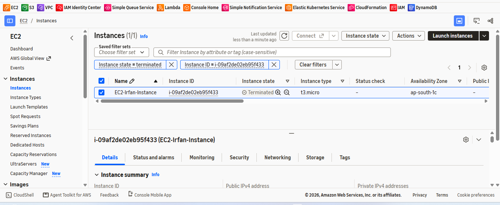

# Terraform Provisioners with AWS EC2 and GitHub Actions CI/CD


## Project Architecture

The following diagram illustrates the complete AWS infrastructure provisioning and CI/CD deployment workflow.



## Project Overview

Designed and implemented an automated AWS infrastructure deployment using **Terraform, AWS EC2, and GitHub Actions**.

The project provisions AWS infrastructure using Terraform, configures an EC2 instance through Terraform provisioners, deploys a Python Flask application, and automates infrastructure deployment through GitHub Actions using AWS OIDC authentication.

Terraform remote state is stored securely in an Amazon S3 backend with state locking enabled.

## Technology Stack

| Technology | Purpose |
|---|---|
| AWS EC2 | Application hosting |
| AWS VPC | Network infrastructure |
| AWS Security Groups | Network access control |
| AWS IAM | Identity and access management |
| AWS OIDC | Secure GitHub Actions authentication |
| Amazon S3 | Terraform remote state |
| Terraform | Infrastructure as Code |
| Terraform Provisioners | Instance configuration and application deployment |
| GitHub Actions | CI/CD automation |
| Python | Application development |
| Flask | Web application framework |
| Ubuntu | EC2 operating system |
| Git & GitHub | Version control |

## Key Implementations

- Provisioned AWS infrastructure using Terraform.
- Created VPC, subnet, Internet Gateway, route table, and security group.
- Automated EC2 instance creation using Terraform.
- Used `file` provisioner to transfer application files to EC2.
- Used `remote-exec` provisioner to install dependencies and configure the application.
- Deployed a Flask application automatically when the EC2 instance was provisioned.
- Configured Amazon S3 as a Terraform remote backend.
- Enabled S3 state locking to prevent concurrent Terraform operations.
- Integrated GitHub Actions for automated Terraform deployment.
- Configured AWS IAM OIDC authentication to avoid storing long-lived AWS access keys in GitHub.
- Stored SSH key material securely in GitHub repository secrets.
- Restricted SSH access to the GitHub Actions runner's public IP.
- Created a separate GitHub Actions workflow for infrastructure destruction.

## Project Implementation & Screenshots

### 1. Terraform Configuration Validation

Validated Terraform configuration using GitHub Actions.



### 2. GitHub Actions CI/CD Pipeline

Automated infrastructure deployment through GitHub Actions.



### 3. Terraform Plan

Reviewed infrastructure changes before applying them.



### 4. Terraform Apply

Provisioned AWS infrastructure automatically through the CI/CD pipeline.



### 5. AWS EC2 Instance

Verified successful EC2 instance provisioning in AWS.



### 6. Flask Application Deployment

Verified that the Flask application was running successfully on the EC2 instance.



### 7. Terraform Remote State on S3

Verified that Terraform remote state was stored in the Amazon S3 bucket.



### 8. Infrastructure Destruction

Executed the separate GitHub Actions workflow to destroy the provisioned infrastructure.



### 9. EC2 Instance Termination

Verified successful termination of the EC2 instance after Terraform destroy.



## CI/CD Workflow

The deployment pipeline performs the following operations:

1. Checks out the source code.
2. Authenticates with AWS using GitHub OIDC.
3. Sets up Terraform.
4. Retrieves SSH keys from GitHub Secrets.
5. Detects the GitHub Actions runner's public IP.
6. Validates Terraform formatting.
7. Initializes the Terraform working directory.
8. Validates Terraform configuration.
9. Generates a Terraform execution plan.
10. Applies the infrastructure changes.
11. Deploys the Flask application on EC2.

A separate manually triggered workflow executes `terraform destroy` to remove the infrastructure.

## Security & Best Practices

- Used AWS OIDC federation for GitHub Actions authentication.
- Avoided hardcoding AWS credentials in source code.
- Stored sensitive SSH key material in GitHub Secrets.
- Used an S3 remote backend for centralized Terraform state management.
- Enabled S3 state locking.
- Restricted SSH ingress to the GitHub Actions runner IP.
- Excluded Terraform state files, private keys, and local provider files from Git version control.

## Project Structure

```text
terraform-provisioners-github-actions/
│
├── .github/
│   └── workflows/
│       ├── terraform.yml
│       └── terraform-destroy.yml
│
├── screenshots/
│   ├── 01-terraform-validation.png
│   ├── 02-github-actions-success.png
│   ├── 03-terraform-plan.png
│   ├── 04-terraform-apply.png
│   ├── 05-ec2-instance.png
│   ├── 06-flask-application.png
│   ├── 07-s3-terraform-state.png
│   ├── 08-terraform-destroy.png
│   └── 09-ec2-terminated.png
│
├── .gitignore
├── .terraform.lock.hcl
├── app.py
├── main.tf
└── README.md
```

## Deployment

### Prerequisites

- AWS account
- Terraform installed
- Git installed
- GitHub repository
- AWS IAM role configured for GitHub OIDC
- Required GitHub repository secrets configured

### Local Deployment

```bash
terraform init
terraform fmt
terraform validate
terraform plan
terraform apply
```

### Destroy Infrastructure

```bash
terraform destroy
```

Alternatively, trigger the **Terraform Destroy AWS Infrastructure** workflow manually from GitHub Actions.

## Key Learnings

- Infrastructure as Code using Terraform.
- AWS infrastructure provisioning and networking.
- Terraform provisioners and remote instance configuration.
- Terraform remote state management using Amazon S3.
- GitHub Actions CI/CD pipeline implementation.
- AWS IAM roles and OIDC-based authentication.
- Secure handling of SSH keys and GitHub Secrets.
- Automated application deployment on AWS EC2.
- Infrastructure lifecycle management using Terraform.

## Author

**Irfan Ahmad**  
DevOps Engineer

- **Repository:** [Terraform Provisioners GitHub Actions](https://github.com/Irfan-devops1/terraform-provisioners-github-actions)

- **GitHub:** [Irfan-devops1](https://github.com/Irfan-devops1)

---

*This project demonstrates practical implementation of Infrastructure as Code, AWS automation, secure CI/CD integration, and automated application deployment.*